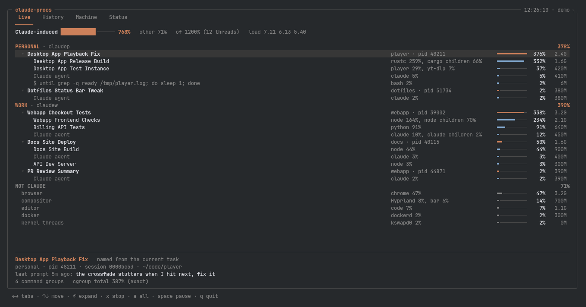
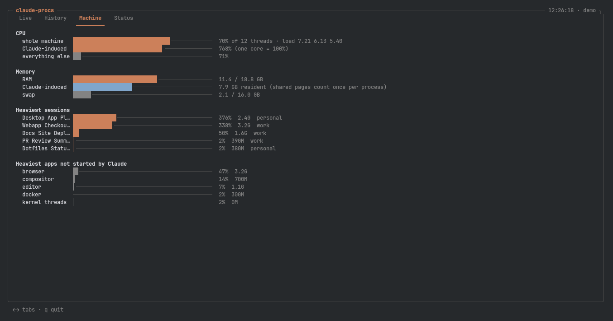
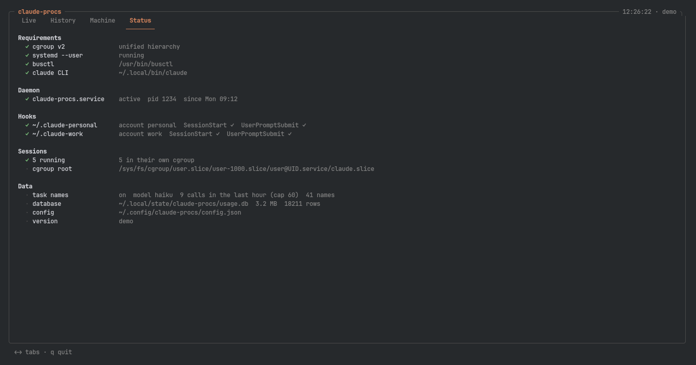

# claude-procs

**See which Claude Code session, and which task, is using your CPU and RAM.**

You run a few Claude Code sessions, `htop` says `node` and `rustc` are eating your machine, and you
have no idea which session started them or what for. `claude-procs` puts every process a session
spawns into that session's own cgroup, names the task it is working on, and shows it all in a
`/status`-style terminal view:



Every session is named after what it is doing right now ("Webapp Checkout Tests"), every heavy
command after what it is ("Billing API Tests"), and short-lived processes like `rustc` are counted
exactly, because the kernel accounts them to the session's cgroup even when they live for 200 ms.

Other "top for Claude Code" tools track **tokens and cost**. This one tracks **CPU and memory on
your machine**.

| History | Machine | Status |
|---|---|---|
|  |  |  |

## Install

Linux with systemd (cgroup v2), Python 3.10+, and the Claude Code CLI.

```sh
uv tool install git+https://github.com/y-essine/claude-procs   # or: pipx install git+https://…
claude-procs install
claude-procs
```

Want to look first? `claude-procs --demo` opens the view on made-up data and touches nothing.

`install` finds every Claude Code config dir (`~/.claude`, `~/.claude-*`, `$CLAUDE_CONFIG_DIR`),
adds two hooks to each `settings.json` (a backup is kept next to it), starts a small systemd user
service and moves already-running sessions into their own cgroup. `claude-procs uninstall` undoes
it (`--purge` also deletes the history).

### Several accounts

If you run Claude Code with different config dirs (say a personal and a work account), each one is
tracked and shown separately. Tell the view how you launch them:

```sh
alias claudep='CLAUDE_CONFIG_DIR=~/.claude-personal claude'
alias claudew='CLAUDE_CONFIG_DIR=~/.claude-work claude'
claude-procs install --alias personal=claudep --alias work=claudew
```

## Use

`claude-procs` opens the interactive view:

| key | |
|---|---|
| `←` `→` / `tab` / `1`–`4` | switch tab: Live, History, Machine, Status |
| `↑` `↓` / `j` `k`, `PgUp` `PgDn` | move |
| `enter` | collapse / expand a session (`e`: all) |
| `x` | stop the selected command and its children (SIGTERM, asks first; never the agent itself) |
| `a` | show idle rows too |
| `t` / `g` | History: time window, group by task / session / project / command / process |
| `space` | pause |
| `q` | quit |

Scriptable commands:

```sh
claude-procs top --once              # plain-text snapshot
claude-procs who 48211               # which session / task / command started this pid
claude-procs report --since 7d --by project
claude-procs status                  # health check
```

`cprocs` is a short alias for `claude-procs`.

## How it works

1. **SessionStart hook**: moves the `claude` process (and anything it already started) into a
   transient systemd scope, `claude.slice/claude-<account>.slice/cc-<account>-<pid>.scope`, bound to
   the terminal it came from (closing the terminal still cleans everything up). From then on the
   kernel accounts every descendant to that scope. `systemd-cgtop` sees it too.
2. **UserPromptSubmit hook**: logs each prompt. A prompt is "the task" until the next one.
3. **Daemon** (`claude-procs.service`): every 5 s it reads `/proc`, attributes each process to its
   session (cgroup first, then the `CLAUDE_PID` variable every Claude-spawned process inherits, which
   also catches GUI apps launched through the compositor), groups it under the Bash command or MCP
   server it descends from, and writes per-minute totals to SQLite. CPU time of processes that start
   and exit between two samples is recovered from their parent's `cutime`, so builds are counted in
   full. It costs about 1% of one core.
4. **Names**: about 40 s after a prompt, and for every command that has used 30 CPU-seconds, a tiny
   tool-less call to Haiku names it, on the same account as the session, at most 60 calls an hour.
   A `/rename` title always wins. Without names you still get everything, just labelled with the
   project and the raw command line.

## Privacy

Everything stays on your machine (`~/.local/state/claude-procs/usage.db`), except the naming calls:
they send the last few prompts of a session and the heaviest command lines (truncated) to the model,
with the session's own account, like Claude Code itself does. Turn them off with `"names": false` in
the config.

## Configuration

`~/.config/claude-procs/config.json`:

```json
{
  "interval": 5,
  "names": true,
  "names_model": "haiku",
  "names_per_hour": 60,
  "claude_bin": "/home/you/.local/bin/claude",
  "aliases": {"personal": "claudep", "work": "claudew"},
  "retain_days": 60
}
```

Restart the daemon after changes: `systemctl --user restart claude-procs`.

## Limits

- Linux only (cgroups, `/proc`, systemd). Without a systemd user session nothing is moved into
  cgroups.
- Docker containers run under the Docker daemon, not your session, so they show up as "not Claude".
- Memory allocated before a running session was adopted stays charged to its old cgroup; per-process
  RSS counts shared pages once per process.

## Development

```sh
uv tool install --editable .
uvx --with pytest pytest -q --import-mode=importlib -o pythonpath=src
uvx ruff check src tests
```

MIT licensed.
