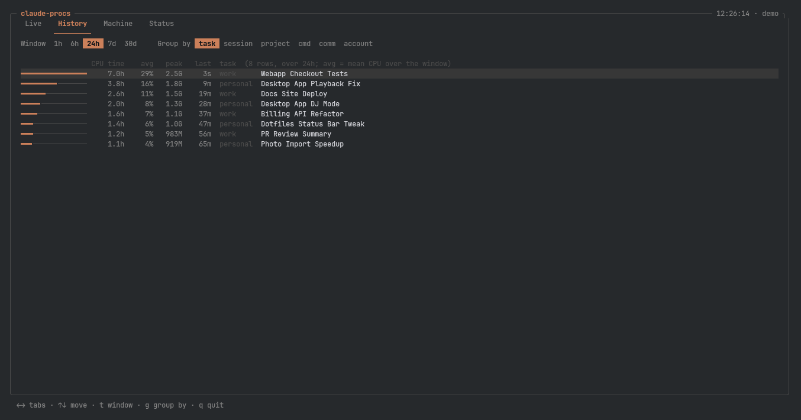

# claude-procs

**See which Claude Code session, and which task, is using your CPU and RAM.**

You run a few Claude Code sessions, `htop` says `node` and `rustc` are eating your machine, and you
have no idea which session started them or what for. `claude-procs` tracks every process each
session spawns, names the task it is working on, and shows it all in a `/status`-style terminal view:


- Every session is named after what it is doing **right now** ("Webapp Checkout Tests"), every heavy
  command after what it is ("Billing API Tests"), not `node 48211`.
- Short-lived processes are counted too: on Linux each session gets its own cgroup, so the kernel
  accounts a 200 ms `rustc` to the session that started it.
- Personal and work accounts (different `CLAUDE_CONFIG_DIR`s) are tracked separately.
- History per task, session, project, command or process; stop a runaway command from the view.

Other "top for Claude Code" tools track **tokens and cost**. This one tracks **CPU and memory on
your machine**.

## Install

Linux (systemd, cgroup v2) or macOS, Python 3.9+, Claude Code. No dependencies.

**Claude Code plugin**: tracking starts with your next session, nothing else to set up.

```
/plugin install cprocs --marketplace y-essine/claude-procs
```

(Older Claude Code: `/plugin marketplace add y-essine/claude-procs`, then `/plugin install cprocs@cprocs`.)
Then ask Claude *"what's using my CPU?"*.

**Command line**: the terminal view everywhere, plus a permanent background service.

```sh
uv tool install claude-procs     # or: pipx install claude-procs · npm i -g claude-procs · yay -S claude-procs
claude-procs install
claude-procs
```

Look first, touch nothing: `uvx claude-procs --demo` or `npx claude-procs --demo`.

`install` finds every Claude Code config dir (`~/.claude`, `~/.claude-*`, `$CLAUDE_CONFIG_DIR`),
adds two hooks to each `settings.json` (a backup is kept next to it), starts a background service
(systemd user unit or launchd agent) and adopts sessions that are already running.
`claude-procs uninstall` undoes it (`--purge` also deletes the history). Plugin and command line can
be used together.

### Several accounts

```sh
alias claudep='CLAUDE_CONFIG_DIR=~/.claude-personal claude'
alias claudew='CLAUDE_CONFIG_DIR=~/.claude-work claude'
claude-procs install --alias personal=claudep --alias work=claudew   # labels in the view
```

## Use

`claude-procs` (or `cprocs`) opens the view:

| key | |
|---|---|
| `←` `→` / `tab` / `1`–`4` | Live, History, Machine, Status |
| `↑` `↓` / `j` `k`, `PgUp` `PgDn` | move |
| `enter` | collapse / expand a session (`e`: all) |
| `x` | stop the selected command and its children (asks first; never a Claude agent) |
| `a` | show idle rows too |
| `t` / `g` | History: time window / group by task, session, project, command, process |
| `space` | pause |
| `q` | quit |

| History | Machine | Status |
|---|---|---|
|  |  |  |

Scriptable:

```sh
claude-procs top --once                       # plain-text snapshot
claude-procs who 48211                        # which session / task / command started pid 48211
claude-procs report --since 7d --by project   # history
claude-procs status                           # health check
```

### In Claude Code's status line

`claude-procs statusline` prints this session's CPU, memory and heaviest command, for example
`⚙ 245% 1.6G · Webapp Frontend Checks`. Use it alone:

```json
{ "statusLine": { "type": "command", "command": "claude-procs statusline", "refreshInterval": 5 } }
```

or append it to your own status line script: `input=$(cat); ...; echo "$input" | claude-procs statusline`.

## How it works

1. **SessionStart hook**: on Linux, moves the `claude` process (and anything it already started)
   into a transient systemd scope, `claude.slice/claude-<account>.slice/cc-<account>-<pid>.scope`,
   bound to the terminal it came from, so closing the terminal still cleans everything up. From then
   on the kernel accounts every descendant to that scope (`systemd-cgtop` sees it too).
2. **UserPromptSubmit hook**: logs each prompt. A prompt is "the task" until the next one.
3. **Sampler** (background service): every 5 s it reads the process table, attributes each process to
   its session (cgroup first, then the `CLAUDE_PID` variable every Claude-spawned process inherits,
   which also catches GUI apps and detached servers), groups it under the Bash command or MCP server
   it descends from, and writes per-minute totals to SQLite. CPU of processes that start and exit
   between two samples is recovered from their parent's `cutime`, so builds count in full. About 1%
   of one core.
4. **Names**: ~40 s after a prompt, and for each command past 30 CPU-seconds, one tiny tool-less
   Haiku call names it, on the session's own account, at most 60 an hour. A `/rename` title wins.

**macOS** has no cgroups: attribution uses the process tree and `CLAUDE_PID` (read with
`sysctl(KERN_PROCARGS2)`), and processes that live less than one sample interval are not counted.

## Privacy

Everything stays on your machine (`~/.local/state/claude-procs/usage.db`) except the naming calls,
which send a session's last few prompts and heaviest command lines (truncated) to the model, with
that session's own account, as Claude Code itself does. Turn them off with `"names": false`.

## Configuration

`~/.config/claude-procs/config.json`:

```json
{
  "interval": 5,
  "names": true,
  "names_model": "haiku",
  "names_per_hour": 60,
  "claude_bin": null,
  "aliases": {"personal": "claudep", "work": "claudew"},
  "retain_days": 60
}
```

Restart the service after changes (`systemctl --user restart claude-procs`, or
`launchctl kickstart -k gui/$UID/io.github.y-essine.claude-procs`).

## Limits

- Linux and macOS only. Without a systemd user session nothing is moved into cgroups (attribution
  falls back to the process tree, as on macOS).
- Docker containers run under the Docker daemon, not your session, so they count as "not Claude".
- Memory allocated before a running session was adopted stays charged to its old cgroup; per-process
  RSS counts shared pages once per process.

## Development

```sh
uv tool install --editable .        # then: systemctl --user restart claude-procs
uvx --with pytest pytest -q --import-mode=importlib -o pythonpath=src
uvx ruff check src tests
claude plugin validate --strict .
python3 scripts/bump.py 0.2.0       # versions everywhere; tag vX.Y.Z to release (PyPI, npm, GitHub)
```

MIT licensed. Not affiliated with Anthropic.
